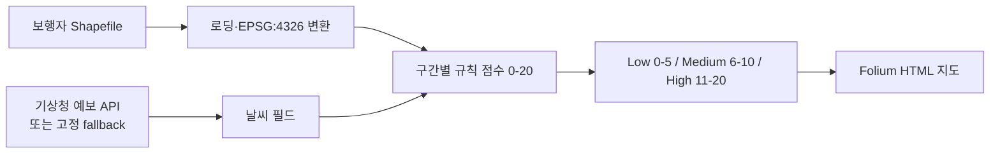

# Fallin: 고령 보행자 낙상 위험 GIS 지도 프로토타입

[English](README.md) · [사례 연구](PORTFOLIO.ko.md)

인천의 보행 구간마다 경사, 기록된 위험요소(턱·계단·급경사로), 조도, 날씨로 실외 낙상 위험 점수를 매기고 대화형 지도에 표시하는 프로토타입입니다. 투명한 규칙 점수이며, 검증된 낙상 예측 모델이나 임상 모델이 아닙니다.

**의사결정 질문.** 낙상 사고 라벨 없이 공공 지형·위험요소·날씨 데이터만 있을 때, 고령 보행자 안내와 보도 정비를 위해 어떤 보행 구간을 먼저 표시해야 하는가?

**핵심 결과.** 위험 등급은 구간 자체보다 날씨에 더 크게 좌우됩니다. CLI는 지도 전체에 예보 하나를 적용해, 최대 20점 중 0~9점을 모든 구간에 똑같이 더합니다. 내장된 겨울 fallback 날씨에서는 어떤 구간도 Low가 될 수 없고, 경사 5도 초과면 모두 High입니다. 맑은 날에는 경사 7도 초과, 위험요소 3개 이상, '어두움' 조도 라벨을 모두 갖춘 구간만 High가 됩니다([규칙 민감도](#결과-규칙-민감도) 참고). 인주대로 현장 확인에서는 표시된 구간에 횡단보도 턱과 육교 계단이 있었습니다. 관찰 한 건이며 검증은 아닙니다.

**배경과 역할.** 제11회 인천광역시 공공데이터 활용 경진대회에 2인 팀으로 낸 아이디어 기획 제안서입니다. 제안서 역할표에는 제가 CTO / S/W 개발 총괄로 기록되어 있습니다.

## 데이터와 가정

- 인천 오픈데이터 '이동약자 보행자 네트워크'의 인도 폴리곤을 썼습니다. 평균 경사는 고도 표면에서 계산했고, 위험요소 수는 경사로·계단급경사·보도 턱·횡단보도 턱 4개 시설 레이어를 합친 지점에서 셌습니다(노트북 `경사.ipynb`, `경사도계산.ipynb`, `위험도계산_지도시각화.ipynb`).
- 기상청 단기예보 필드(`TMP`, `REH`, `PTY`, `PCP`, `SNO`, `WSD`)를 씁니다. `KMA_SERVICE_KEY`가 없으면 고정된 겨울 시나리오를 씁니다.
- `data/`의 `.shp` 파일 두 개에는 `.dbf`/`.shx` 구성 파일이 없어, 이 체크아웃에서 구간 수와 속성을 읽을 수 없습니다.

## 점수 설계



| 요인 | 규칙(`src/risk_calculator.py`) | 점수 |
|---|---|---:|
| 경사 | 7도 초과 / 5도 초과 | 5 / 3 |
| 기록된 위험요소 | 3개 이상 / 1개 이상 | 5 / 3 |
| 조도 | 라벨이 '낮음' 또는 '어두움' | 1 |
| 날씨 | 기온 0도 이하, 습도 90 이상, 비·눈 형태, 강수량 > 0, 적설 > 0, 풍속 5m/s 이상 | 2, 1, 2, 1, 2, 1 |

가중치는 낙상 사고에 맞춰 추정한 계수가 아니라 설계 가정입니다.

## 결과: 규칙 민감도

`python scripts/rule_sensitivity.py` 출력입니다. 유지되는 `RiskCalculator`를 합성 구간에 실행합니다.

| 구간 | 맑은 날씨 | fallback 날씨 |
|---|---|---|
| 평지, 위험요소 없음, 밝음 | 0, Low | 9, Medium |
| 경사 6도 | 3, Low | 12, High |
| 경사 8도 + 위험요소 3개 | 10, Medium | 19, High |
| 경사 8도 + 위험요소 3개 + 어두움 | 11, High | 20, High |
| 경사 8도 + 위험요소 3개 + 숫자 조도값 | 10, Medium | 19, High |

이 표가 보여 주는 것:

- 한 번 실행할 때 날씨는 모든 구간에 같으므로, 구간 간 순위는 경사·위험요소·조도(최대 11점)로만 정해집니다.
- 가중치만큼 등급 경계도 중요합니다. 경진대회 노트북은 다른 경계(0~3 낮음, 4~6 주의, 7 이상 높음)를 써서, 같은 점수에서도 High 구간이 더 많아집니다.
- 노트북에서 불러온 데이터의 조도 컬럼은 숫자(예: 22786)인데, 규칙은 텍스트 라벨을 확인합니다. 이런 입력에서는 조도 규칙이 작동하지 않고, 맑은 날에는 어떤 구간도 High에 도달할 수 없습니다.


*그림 1. 경진대회 제안서 그림입니다. 왼쪽은 남동구 인주대로 일대 낙상 위험 지도, 오른쪽은 노란색으로 표시된 지점의 거리 사진으로 횡단보도 턱과 육교 계단이 보입니다. 현장 확인 한 건이며 정확도 측정이 아닙니다.*

## 이 결과가 보여 주지 않는 것

- 사고 라벨, 경로 결과, 현장 검증 기록이 없으므로 점수가 낙상을 예측하거나 경로가 사고를 줄인다는 근거가 없습니다.
- 제안서의 목표치(예: 낙상 예측 정확도 85%)는 계획이며 측정 결과가 아닙니다.
- 제안서의 앱 기능(안전 경로, 보호자 알림, 스마트폰 충격 감지)은 이 저장소에 구현되어 있지 않습니다.
- fallback 날씨로 만든 지도는 어느 시점의 실제 날씨도 반영하지 않습니다.

## 실행

규칙 민감도 스모크 테스트(pandas만 필요):

```powershell
python scripts/rule_sensitivity.py
```

전체 지도(GeoPandas·Folium과 구성 파일을 모두 갖춘 Shapefile 필요):

```powershell
pip install -r requirements.txt
python main.py --shapefile "path\to\pedestrian_network.shp"
```

기상청 API를 쓰려면 `KMA_SERVICE_KEY`를 설정합니다. 없으면 fallback 날씨를 씁니다. HTML 지도와 실행 로그를 `results/`에 씁니다.

## 저장소 구조

```text
main.py                     # CLI: 로딩 -> 날씨 -> 점수 -> 지도
src/                        # GIS 로더, 기상청 클라이언트, 규칙 점수, 지도
scripts/rule_sensitivity.py # 합성 구간의 점수·등급 표
notebooks/                  # 원본 경사, 조도·날씨, 점수 계산 작업
reports/                    # 경진대회 제안서
images/                     # 제안서 지도와 서비스 목업
```

## 링크

- [사례 연구: 의사결정과 트레이드오프](PORTFOLIO.ko.md)
- [프로젝트 리뷰](docs/PROJECT_REVIEW.md)
- [경진대회 제안서](reports/fallin_incheon_open_data.pdf)

라이선스 파일이 없으므로 코드는 기본적으로 저작권자에게 모든 권리가 있습니다.
