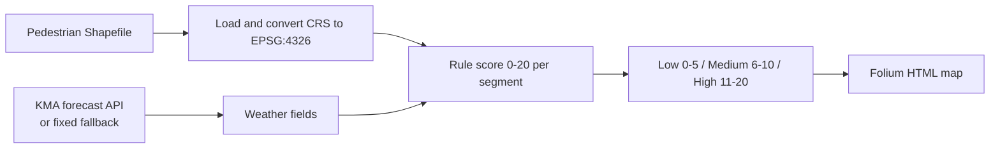

# Fallin: A GIS Fall-Risk Mapping Prototype for Older Pedestrians

[한국어](README.ko.md) · [Case study](PORTFOLIO.md)

Scores each pedestrian path segment in Incheon 0–20 for outdoor fall risk from
slope, recorded hazards, lighting, and weather, and draws the result on an
interactive map. A transparent rule score, not a fitted fall-prediction model.

**Problem.** Without fall-incident labels, which segments should be flagged
first for older pedestrians and street repair?

**Result.** On six test segments, slope, hazards, and lighting (max 11 of 20 points) set the ranking, from 0 for a flat lit path to 11 for steep, hazardous, and dark; weather (max 9) lifts every segment equally, so under the winter fallback no segment is Low. Use the ranking for repair priority and the level for same-day alerts. ([rule sensitivity](#rule-sensitivity))

**Scope.** Weights and cut-offs are design assumptions, not fitted to fall
incidents, and there is no field validation. The map needs a complete Shapefile
(sidecars missing here); `python scripts/rule_sensitivity.py` reruns the rule
sensitivity check with only pandas.

**Context and role.** Idea proposal, 11th Incheon Public Data Use Competition.
Software lead in a two-person team.

## Data

- Incheon open-data "mobility-impaired pedestrian network" polygons; mean slope
  from an elevation surface; hazard counts from four facility layers (ramps,
  stairs/steep slopes, pavement curbs, crosswalk curbs). Notebooks: `경사.ipynb`,
  `경사도계산.ipynb`, `위험도계산_지도시각화.ipynb`.
- KMA short-term forecast (단기예보, `getVilageFcst`): `TMP`, `REH`, `PTY`,
  `PCP`, `SNO`, `WSD` for the forecast hour nearest the run time, from the
  latest issue already served (issued 02, 05, 08, 11, 14, 17, 20, 23 KST,
  available 10 minutes later). Category strings such as "강수없음",
  "1mm 미만", "30.0~50.0mm", "0.5cm 미만" are parsed to numbers (a range maps
  to its lower bound; "below 1 mm" to 0.1). A field that fails to parse is
  logged and only that factor is skipped. Without `KMA_SERVICE_KEY`, a fixed
  winter scenario is used. Source: KMA OpenAPI guide for
  [기상청_단기예보 조회서비스](https://www.data.go.kr/data/15084084/openapi.do).
- The two `.shp` files in `data/` come without `.dbf`/`.shx` sidecars, so the
  map needs a complete Shapefile supplied by the user.

## Scoring design



| Factor | Rule (`src/risk_calculator.py`) | Points |
|---|---|---:|
| Slope | > 7 degrees / > 5 degrees | 5 / 3 |
| Recorded hazards | >= 3 / >= 1 | 5 / 3 |
| Lighting | label "낮음" or "어두움" (low / dark), or illuminance < 2 lx | 1 |
| Weather | `TMP` <= 0 °C, `REH` >= 90 %, `PTY` 1–4 (rain, rain/snow, snow, shower), `PCP` > 0 mm, `SNO` > 0 cm, `WSD` >= 5 m/s | 2, 1, 2, 1, 2, 1 |

The lighting column accepts a text label or a numeric lux reading (the
notebook data holds numbers such as 22786 and 8). A reading below
`DARK_LUX_THRESHOLD = 2.0` lx (`src/config.py`, override with `FALLIN_DARK_LUX`)
counts as dark: 2 lx is the lowest average illuminance among the pedestrian
lighting classes P1–P6 (15 to 2 lx) in EN 13201-2:2015, which follows
CIE 115:2010, so a darker reading meets no pedestrian class. The standard
specifies a maintained average over an area; the rule applies it to a single
reading.

## Rule sensitivity

`python scripts/rule_sensitivity.py` runs `RiskCalculator` on synthetic
segments:

| Segment | Clear weather | Fallback weather |
|---|---|---|
| Flat, no hazards, lit | 0, Low | 9, Medium |
| Slope 6 degrees | 3, Low | 12, High |
| Slope 8 degrees + 3 hazards | 10, Medium | 19, High |
| Slope 8 degrees + 3 hazards + dark | 11, High | 20, High |
| Slope 8 degrees + 3 hazards + 3903 lx | 10, Medium | 19, High |
| Slope 8 degrees + 3 hazards + 1 lx | 11, High | 20, High |

- Weather is identical across segments in a run, so it shifts every segment's
  level without changing their order.
- Under the built-in winter fallback no segment can be Low, and any slope above
  5 degrees is High. In clear weather, only a segment with slope above 7
  degrees, three or more hazards, and dark lighting (a "dark" label or a
  reading below 2 lx) reaches High.
- Cut-offs matter as much as weights: the notebook's 0–3 low, 4–6 caution,
  7+ high yields more High segments from the same scores.


*Figure 1. Proposal figure: fall-risk map around Inju-daero, Namdong-gu
(left); a field spot check found a crosswalk curb and overpass stairs at a
yellow-flagged spot (right).*

## How to run

```powershell
python scripts/rule_sensitivity.py        # smoke test, needs only pandas
python tests/test_weather.py              # KMA parser and slot tests, offline

pip install -r requirements.txt
python main.py --shapefile "path\to\pedestrian_network.shp"
```

The map needs GeoPandas, Folium, and a complete Shapefile; `KMA_SERVICE_KEY`
enables live weather. Writes an HTML map and run log to `results/`.
The weather tests replay hand-written `getVilageFcst` responses in
`tests/fixtures/` (no network); `python -m pytest tests` also works if pytest
is installed.

## Repository layout

```text
main.py                     # CLI: load -> weather -> score -> map
src/                        # GIS loader, KMA weather client, rule scoring, map
scripts/rule_sensitivity.py # Score/level table on synthetic segments
tests/                      # Offline KMA forecast parser/slot tests + fixtures
notebooks/                  # Original slope, lighting/weather, and scoring work
reports/                    # Competition proposal (Korean)
images/                     # Proposal map and service mock-up
```

## Limitations

- Weights and cut-offs are design assumptions, not fitted to fall incidents; there are no incident labels or field-validation logs, and the Inju-daero check is one observation.
- The 2 lx lighting cut-off comes from a design standard for average illuminance, not from fall data, and a single sensor reading depends on when it was taken.
- Fallback-weather maps show no real weather.
- Proposal targets (for example 85% fall-prediction accuracy) and app features (safe routing, caregiver alerts, smartphone impact detection) are plans, not built.

## Links

- [Case study: decisions and trade-offs](PORTFOLIO.md)
- [Competition proposal (Korean)](reports/fallin_incheon_open_data.pdf)
- Lighting threshold source: EN 13201-2:2015 *Road lighting – Part 2: Performance requirements*, P-class table ([reproduced here](https://www.performanceinlighting.com/be/en/en-13201-2-2015)); CIE 115:2010 *Lighting of Roads for Motor and Pedestrian Traffic*

## License

No open-source license: the code and documents are public for review; reuse requires permission.
