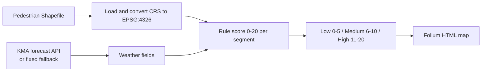

# Fallin: Heuristic GIS Fall-Risk Mapping for Older Pedestrians

[한국어](README.ko.md) · [Case study](PORTFOLIO.md)

This prototype scores pedestrian path segments in Incheon for outdoor fall risk
from slope, recorded hazards (curbs, stairs, steep ramps), lighting, and
weather, then draws them on an interactive map. It is a transparent rule
score, not a validated or clinical fall-prediction model.

**Decision question.** Which walking segments should be flagged first for older
pedestrians, and for street repair, given only public terrain, hazard, and
weather data and no fall-incident labels?

**Headline finding.** Weather decides the risk level more than the segment
does. The CLI applies one forecast to the whole map, adding 0 to 9 of the 20
possible points to every segment. Under the built-in winter fallback weather,
no segment can be Low and any slope above 5 degrees is High. In clear weather,
only a segment with slope above 7 degrees, three or more hazards, and a "dark"
lighting label reaches High (see [rule sensitivity](#findings-rule-sensitivity)).
A field spot check on Inju-daero found that a flagged segment had a crosswalk
curb and overpass stairs. That is one observation, not validation.

**Context and role.** Idea proposal for the 11th Incheon Public Data Use
Competition, by a two-person team. The proposal's role table lists me as CTO /
overall software-development lead.

## Data and assumptions

- Pedestrian network polygons from Incheon open data ("mobility-impaired
  pedestrian network"), with mean slope from an elevation surface and hazard
  counts from points merged out of four facility layers: ramps, stairs/steep
  slopes, pavement curbs, and crosswalk curbs (notebooks `경사.ipynb`, `경사도계산.ipynb`,
  `위험도계산_지도시각화.ipynb`).
- KMA short-term forecast fields (`TMP`, `REH`, `PTY`, `PCP`, `SNO`, `WSD`).
  Without `KMA_SERVICE_KEY` the code uses a fixed winter scenario.
- The two `.shp` files in `data/` lack their `.dbf`/`.shx` sidecars, so the
  segment count and attributes cannot be read from this checkout.

## Scoring design



| Factor | Rule (`src/risk_calculator.py`) | Points |
|---|---|---:|
| Slope | > 7 degrees / > 5 degrees | 5 / 3 |
| Recorded hazards | >= 3 / >= 1 | 5 / 3 |
| Lighting | label "낮음" or "어두움" (low / dark) | 1 |
| Weather | temp <= 0, humidity >= 90, rain/snow type, precipitation > 0, snowfall > 0, wind >= 5 m/s | 2, 1, 2, 1, 2, 1 |

The weights are design assumptions, not coefficients fitted to fall incidents.

## Findings: rule sensitivity

Output of `python scripts/rule_sensitivity.py`, which runs the maintained
`RiskCalculator` on synthetic segments:

| Segment | Clear weather | Fallback weather |
|---|---|---|
| Flat, no hazards, lit | 0, Low | 9, Medium |
| Slope 6 degrees | 3, Low | 12, High |
| Slope 8 degrees + 3 hazards | 10, Medium | 19, High |
| Slope 8 degrees + 3 hazards + dark | 11, High | 20, High |
| Slope 8 degrees + 3 hazards + numeric lux value | 10, Medium | 19, High |

What this shows:

- Within one run, weather is the same for every segment, so the ranking between
  segments comes only from slope, hazards, and lighting (at most 11 points).
- The level cut-offs matter as much as the weights. The competition notebook
  used different cut-offs (0–3 low, 4–6 caution, 7+ high), so the same scores
  produce more High segments there.
- In the notebook's loaded data the lighting column holds numbers (for example
  22786), but the rule checks for the text labels. On such input the lighting
  rule never fires, and in clear weather no segment can reach High.


*Figure 1. Competition proposal figure: fall-risk map around Inju-daero,
Namdong-gu (left), and a street-level view of a yellow-flagged spot showing a
crosswalk curb and overpass stairs (right). It is a single spot check, not a
measure of accuracy.*

## What this does not show

- No incident labels, route outcomes, or field-validation logs are retained, so
  nothing here shows that the score predicts falls or that a route reduces
  them.
- The proposal's targets (for example 85% fall-prediction accuracy) are plans,
  not measured results.
- App features in the proposal (safe routing, caregiver alerts, smartphone
  impact detection) are not implemented in this repository.
- Maps made with the fallback weather do not reflect real weather at any time.

## Run

Rule-sensitivity smoke test (needs only pandas):

```powershell
python scripts/rule_sensitivity.py
```

Full map (needs GeoPandas and Folium, plus a complete Shapefile with its
sidecar files):

```powershell
pip install -r requirements.txt
python main.py --shapefile "path\to\pedestrian_network.shp"
```

Set `KMA_SERVICE_KEY` to use the KMA API; otherwise the fallback weather is
used. The command writes an HTML map and a run log under `results/`.

## Repository layout

```text
main.py                     # CLI: load -> weather -> score -> map
src/                        # GIS loader, KMA weather client, rule scoring, map
scripts/rule_sensitivity.py # Score/level table on synthetic segments
notebooks/                  # Original slope, lighting/weather, and scoring work
reports/                    # Competition proposal (Korean)
images/                     # Proposal map and service mock-up
```

## Links

- [Case study: decisions and trade-offs](PORTFOLIO.md)
- [Project review](docs/PROJECT_REVIEW.md)
- [Competition proposal (Korean)](reports/fallin_incheon_open_data.pdf)

No licence file is included, so the code is all rights reserved by default.
