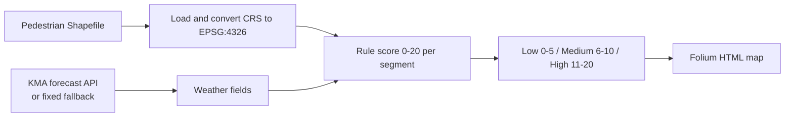

# Fallin: A GIS Fall-Risk Mapping Prototype for Older Pedestrians

[한국어](README.ko.md) · [Case study](PORTFOLIO.md)

Scores each pedestrian path segment in Incheon 0–20 for outdoor fall risk from
slope, recorded hazards, lighting, and weather, and draws the result on an
interactive map. A transparent rule score, not a fitted fall-prediction model.

**Problem.** Without fall-incident labels, which segments should be flagged
first for older pedestrians and street repair?

**Result.** Ranking between segments is set by slope, hazards, and lighting
(up to 11 points); weather (0–9 points) raises every segment's level together,
so the ranking serves maintenance priority and the level serves same-day
alerts ([rule sensitivity](#rule-sensitivity)).

**Scope.** Weights and cut-offs are design assumptions, not fitted to fall
incidents, and there is no field validation. The map needs a complete Shapefile
(sidecars missing here); `python scripts/rule_sensitivity.py` reruns the rule
sensitivity check with only pandas.

**Context and role.** Idea proposal, 11th Incheon Public Data Use Competition.
Software lead in a two-person team.

## Data

- Incheon open-data "mobility-impaired pedestrian network" polygons; mean slope
  from an elevation surface; hazard counts from four facility layers (ramps,
  stairs/steep slopes, pavement curbs, crosswalk curbs). Notebooks: `경사.ipynb`,
  `경사도계산.ipynb`, `위험도계산_지도시각화.ipynb`.
- KMA short-term forecast (`TMP`, `REH`, `PTY`, `PCP`, `SNO`, `WSD`), or a
  fixed winter scenario without `KMA_SERVICE_KEY`.
- The two `.shp` files in `data/` come without `.dbf`/`.shx` sidecars, so the
  map needs a complete Shapefile supplied by the user.

## Scoring design



| Factor | Rule (`src/risk_calculator.py`) | Points |
|---|---|---:|
| Slope | > 7 degrees / > 5 degrees | 5 / 3 |
| Recorded hazards | >= 3 / >= 1 | 5 / 3 |
| Lighting | label "낮음" or "어두움" (low / dark) | 1 |
| Weather | temp <= 0, humidity >= 90, rain/snow type, precipitation > 0, snowfall > 0, wind >= 5 m/s | 2, 1, 2, 1, 2, 1 |

## Rule sensitivity

`python scripts/rule_sensitivity.py` runs `RiskCalculator` on synthetic
segments:

| Segment | Clear weather | Fallback weather |
|---|---|---|
| Flat, no hazards, lit | 0, Low | 9, Medium |
| Slope 6 degrees | 3, Low | 12, High |
| Slope 8 degrees + 3 hazards | 10, Medium | 19, High |
| Slope 8 degrees + 3 hazards + dark | 11, High | 20, High |
| Slope 8 degrees + 3 hazards + numeric lux value | 10, Medium | 19, High |

- Weather is identical across segments in a run, so it shifts every segment's
  level without changing their order.
- Under the built-in winter fallback no segment can be Low, and any slope above
  5 degrees is High. In clear weather, only a segment with slope above 7
  degrees, three or more hazards, and a "dark" lighting label reaches High.
- Cut-offs matter as much as weights: the notebook's 0–3 low, 4–6 caution,
  7+ high yields more High segments from the same scores.


*Figure 1. Proposal figure: fall-risk map around Inju-daero, Namdong-gu
(left); a field spot check found a crosswalk curb and overpass stairs at a
yellow-flagged spot (right).*

## How to run

```powershell
python scripts/rule_sensitivity.py        # smoke test, needs only pandas

pip install -r requirements.txt
python main.py --shapefile "path\to\pedestrian_network.shp"
```

The map needs GeoPandas, Folium, and a complete Shapefile; `KMA_SERVICE_KEY`
enables live weather. Writes an HTML map and run log to `results/`.

## Repository layout

```text
main.py                     # CLI: load -> weather -> score -> map
src/                        # GIS loader, KMA weather client, rule scoring, map
scripts/rule_sensitivity.py # Score/level table on synthetic segments
notebooks/                  # Original slope, lighting/weather, and scoring work
reports/                    # Competition proposal (Korean)
images/                     # Proposal map and service mock-up
```

## Limitations

- Weights and cut-offs are design assumptions, not fitted to fall incidents; there are no incident labels or field-validation logs, and the Inju-daero check is one observation.
- The notebook's lighting column is numeric (for example 22786) while the rule checks text labels, so on that data the lighting point never applies and clear-weather scores cannot reach High.
- Fallback-weather maps show no real weather.
- Proposal targets (for example 85% fall-prediction accuracy) and app features (safe routing, caregiver alerts, smartphone impact detection) are plans, not built.

## Links

- [Case study: decisions and trade-offs](PORTFOLIO.md)
- [Competition proposal (Korean)](reports/fallin_incheon_open_data.pdf)
